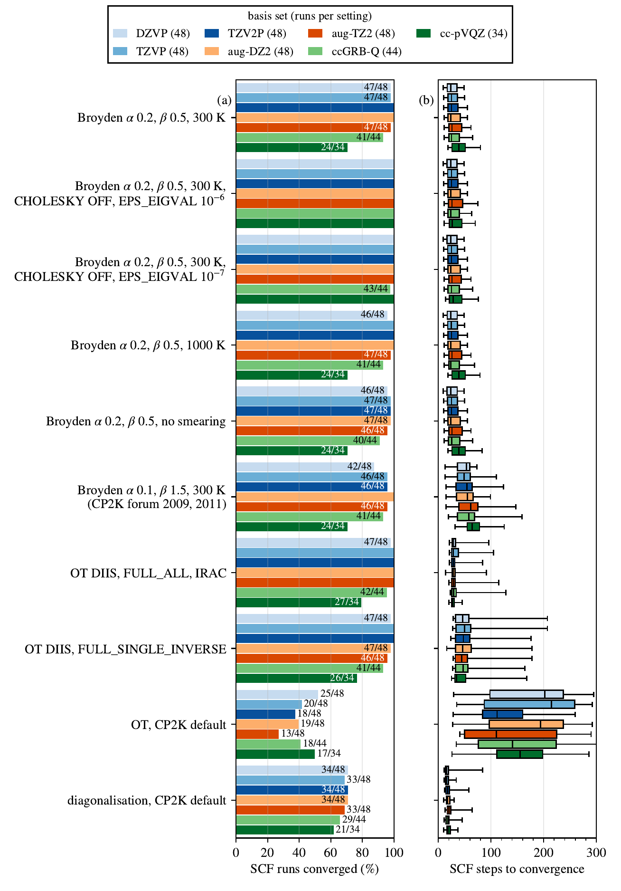
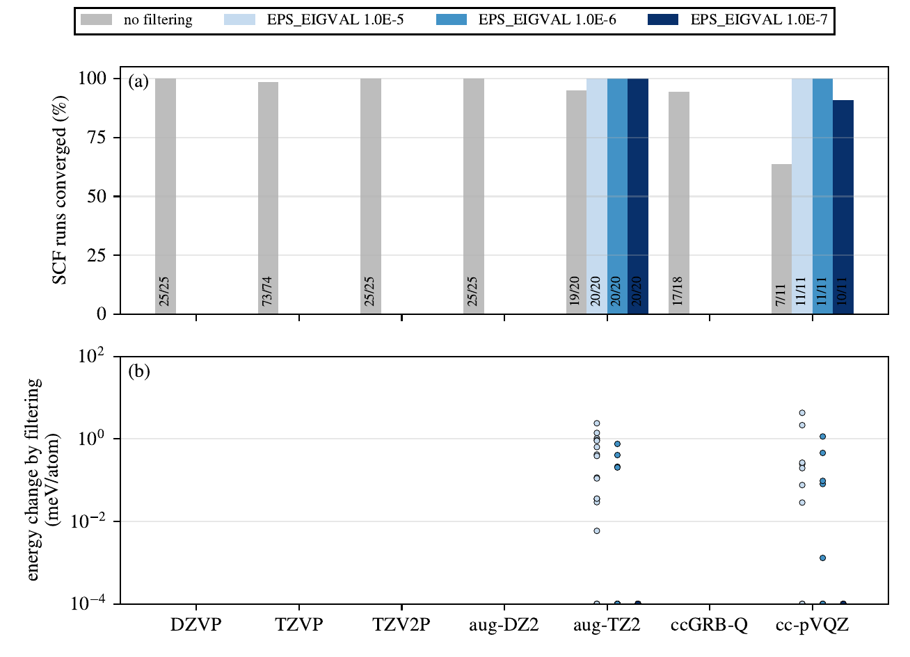

# CP2K SCF settings that always converge

This repository tests which CP2K SCF setting converges every system of a broad test set in **one single run from
`SCF_GUESS ATOMIC`**: no restarts, no two-step runs, and no per-system tuning. The test set contains molecules,
liquids, crystals, surfaces, interfaces and metals with up to 192 atoms, computed with basis sets from DZVP up to
aug-TZVP and cc-pVQZ.

Folder [`closed_shell/`](closed_shell) holds the closed-shell (non-magnetic) systems. Magnetic systems will follow
in a separate folder.

## Recommended setting

Diagonalisation with Broyden mixing (α 0.2, β 0.5 bohr⁻¹, 8 stored densities), Fermi–Dirac smearing at 300 K, and
an overlap matrix filtered with `CHOLESKY OFF` and `EPS_EIGVAL 1.0E-6`:

```
&SCF
  SCF_GUESS ATOMIC
  EPS_SCF 1.0E-8
  MAX_SCF 300
  ADDED_MOS <about 0.2 x number of occupied orbitals + 10>
  CHOLESKY OFF          ! orthogonalisation with S^-1/2 ...
  EPS_EIGVAL 1.0E-6     ! ... overlap eigenvalues below 1e-6 removed
  &DIAGONALIZATION ON
    ALGORITHM STANDARD
  &END DIAGONALIZATION
  &MIXING ON
    METHOD BROYDEN_MIXING
    ALPHA 0.2
    BETA 0.5
    NBUFFER 8
  &END MIXING
  &SMEAR ON
    METHOD FERMI_DIRAC
    ELECTRONIC_TEMPERATURE [K] 300
  &END SMEAR
&END SCF
```

Use the same setting for insulators and metals, and for small and large basis sets.

**Result:**
- This setting converges **198 of 198 runs**: 131 runs with a band gap and 67 without.
- Every run reaches the ground state. In each case the final energy equals the reference energy (definition below).
- Number of SCF steps:

  | Runs | Median | Maximum |
  |---|---|---|
  | With a band gap | 27 | 68 |
  | Without a band gap | 35 | 193 |

**Why `EPS_EIGVAL` is needed.** Without the overlap filtering, the same mixing converges only 192 of 198 runs. All six
failures use nearly linearly dependent basis sets:
- cc-pVQZ in dense solids;
- ccGRB-Q for bulk MgO;
- aug-TZ2 for Au(111).

With cc-pVQZ and no filtering, the diagonalisation can even end several hartree *below* the true energy (collapse).

**Effect of the filtering on the energy:**
- DZVP, TZVP, TZV2P and aug-DZ2: at most 0.03 meV/atom.
- aug-TZ2: up to 0.8 meV/atom.
- ccGRB-Q: up to 0.4 meV/atom.
- cc-pVQZ: up to 1.1 meV/atom.

**Origin of the mixing parameters.** α 0.2, β 0.5 come from this benchmark; β 0.5 is the CP2K default. The CP2K
forum suggests a different setting for metals: Broyden α 0.1, β 1.5, NBROYDEN 8, 300 K.
- Sources: J. Hutter, 1 Dec 2009, [Rh(111) surface](https://groups.google.com/g/cp2k/c/MXYYuJmf1s0); M. Iannuzzi,
  4 Oct 2011, [metallic systems](https://groups.google.com/g/cp2k/c/OQczYEVvpME).
- That setting converges about as many runs but needs about twice as many SCF steps (median 64).

**CP2K defaults converge far less often:**

| CP2K default setting | Runs converged |
|---|---|
| OT | 37 of 131 runs with a gap |
| Diagonalisation | 89 of 131 runs with a gap |
| Smearing with the default mixing | 17 of 67 runs without a gap |

## Comparison of SCF settings

### Systems with a band gap

The figure below shows the same 131 runs (49 systems, all basis sets) for every setting:
- (a) SCF runs converged;
- (b) SCF steps of the converged runs (box: 25–75 %, line: median, whiskers: minimum and maximum).

α is the mixing parameter and β the Kerker damping wave vector in bohr⁻¹. Runs of the OT and default settings that were
still running after 60–120 min (the time limit per run) count as not converged.



### Metals and graphene-like systems

The figure below shows the same 67 runs, all with Fermi–Dirac smearing.


### Basis sets and overlap filtering

The figure below shows Broyden mixing (α 0.2, β 0.5 bohr⁻¹) per basis set, without and with overlap filtering:
- (a) SCF runs converged;
- (b) energy change caused by the filtering.



### Comparison with Quantum ESPRESSO

The converged CP2K results were compared with Quantum ESPRESSO 7.3.1, using the same GTH-PBE pseudopotentials, the
same structures and the Γ point. With aug-TZVP tier-2 the results agree as follows:

| Quantity | Systems | Agreement |
|---|---|---|
| HOMO–LUMO gap | Si, GaAs, MoS₂, liquid water, bulk MgO, MgO(100)/water | within 5 meV |
| HOMO–LUMO gap | MgO(100) | 52 meV |
| Electron density | all seven systems with a gap | 0.3–0.5 % of the electrons distributed differently |

QE uses the highest plane-wave cutoff that converged (200–800 Ry; MgO needs 600–800 Ry). In panel (a), metals and
graphene are left out.


## Definitions

- **SCF step**: one diagonalisation of the Kohn–Sham matrix and one density update, i.e. one line of the CP2K SCF
  output.
- **Converged**: a run counts as converged only if both conditions hold:
  1. CP2K reports SCF convergence (`EPS_SCF 1.0E-8`) within 300 SCF steps;
  2. the final energy agrees with the reference energy of the same system and basis set within 0.01 meV/atom (with
     gap) or 0.1 meV/atom (without gap), so the SCF did not end in a wrong state.
- **Reference energy**: the lowest final energy that at least two different settings reproduce. A single lower energy
  (collapse in a nearly singular basis) is not used.
- **Filtered runs** (`EPS_EIGVAL`) solve the problem in a slightly smaller basis. They count as converged if CP2K
  converged and their energy is not more than 1 meV/atom below the unfiltered reference.

## Test set and method

**Method:**
- PBE with GTH-PBE pseudopotentials (`POTENTIAL_UZH`).
- `CUTOFF` 600 Ry, `REL_CUTOFF` 60 Ry, `EPS_DEFAULT 1.0E-12`, Γ point.
- CP2K 2026.2 development version (master of 22 Nov 2026).

**Systems:** 49 systems with 5–192 atoms, listed in [`closed_shell/systems.csv`](closed_shell/systems.csv):

| Set | Systems | Content |
|---|---|---|
| `stage1` | 25 | molecules, liquids, bulk, 2D, slabs, interfaces with water, metals; used to choose the settings |
| `validation` | 24 | further systems, never used to choose the settings |
| `displaced` | 25 | the `stage1` structures with every atom displaced randomly by up to 0.1 Å |

**Basis sets:**

| Basis set label | CP2K basis set | Systems |
|---|---|---|
| DZVP, TZVP | `DZVP-`/`TZVP-MOLOPT-PBE-GTH` | DZVP: `stage1` only; TZVP: all systems |
| TZV2P | `TZV2P-MOLOPT-PBE-GTH` | all 25 `stage1` systems |
| aug-DZ2 | `aug-DZ2-MOLOPT-PBE-GTH`, else `aug-DZVP-MOLOPT-GTH-tier-2` | all 25 `stage1` systems |
| aug-TZ2 | `aug-TZ2-MOLOPT-PBE-GTH`, else `aug-TZVP-MOLOPT-GTH-tier-2` | `stage1` systems with at most 100 atoms |
| ccGRB-Q | `ccGRB-Q` | `stage1` systems with at most 100 atoms |
| cc-pVQZ | `cc-pVQZ-GTH` (Ye and Berkelbach, [github.com/hongzhouye/ccgto](https://github.com/hongzhouye/ccgto); converted file `closed_shell/BASIS_ccGTO_YE`) | 11 systems, H–Ar only |

**Runs:** each run is one system in one basis set with one setting: 198 runs per setting, 3068 runs in total for
43 settings.

## Files

| Path | Content |
|---|---|
| `closed_shell/runs/<set>/<system>/<basis>/run.inp`, `run.out` | CP2K input and output of all 198 runs with the recommended setting |
| `closed_shell/results/all_runs.csv` | All 3068 runs of all 43 settings: set, system, basis, setting, class (`gap`/`nogap`), atoms, CP2K converged (0/1), SCF steps, energy minus reference (meV/atom), converged by the definition above (0/1) |
| `closed_shell/systems.csv` | The 49 systems with set, group, class, number of atoms and charge |
| `closed_shell/BASIS_ccGTO_YE` | cc-pVQZ basis sets in CP2K format |

**Naming of settings in `all_runs.csv`:**
- `smear300_` / `smear1000_`: Fermi–Dirac smearing at 300 K or 1000 K.
- `diag_`: diagonalisation without smearing.
- `broyden_a0.2_b0.5_nb8`: Broyden mixing, α 0.2, β 0.5, NBUFFER 8.
- `kerker_`: Kerker mixing.
- `_eigval1.0E-6`: `CHOLESKY OFF`, `EPS_EIGVAL 1.0E-6`.
- `ot_diis_full_all_gap0.01_irac_20x15`: OT with DIIS, preconditioner FULL_ALL, `ENERGY_GAP 0.01`, `ALGORITHM IRAC`,
  20 inner steps × 15 outer steps.
- `*_cp2k_default`: the CP2K defaults.

To run an input, set `BASIS_SET_FILE_NAME BASIS_ccGTO_YE` to the path of `closed_shell/BASIS_ccGTO_YE`.

## Limits

**Largest basis set: aug-ccGRB-Q.** This is ccGRB-Q plus the diffuse functions aug-cc-Q, the largest basis set in the
CP2K data directory. No single `EPS_EIGVAL` works for all systems:
- `1.0E-7`: most runs diverge.
- `1.0E-6`: almost all runs converge, but for TiO₂ and MgO(100)/water the SCF residual stalls or diverges, and some
  energies are implausible (TiO₂ anatase ends 5 hartree below TZVP).
- `1.0E-5`: the runs converge, but energies lie up to 120 meV/atom above the smaller basis sets (TiO₂).

The recommended setting is therefore tested up to aug-TZ2 and cc-pVQZ. These runs are still being evaluated and are
not in this repository.

**MoS₂** is missing for ccGRB-Q, because CP2K cannot read `BASIS_ccGRB_UZH` for Mo.
